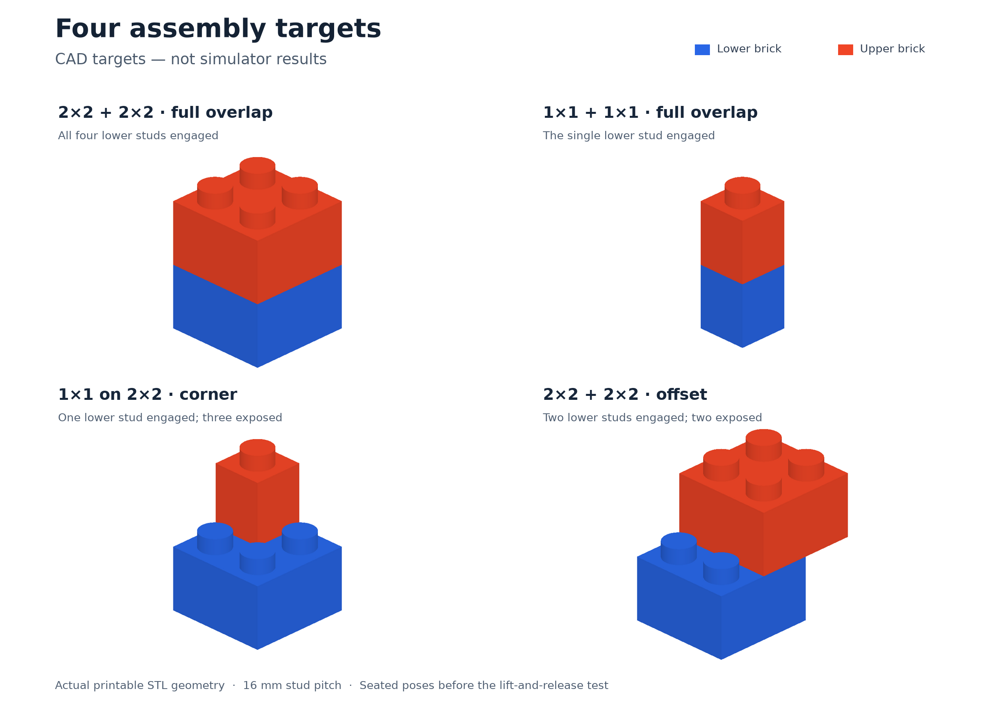

# Four brick-joining tasks

Four separate tasks, all using custom printable bricks at Duplo scale. These are
not official LEGO parts. The one-stud brick is the custom design you chose.

Each task asks the robot to press red onto blue, lift the pair by red alone, then
set it down and let go. The unsupported lift distinguishes a retained joint
from a loose stack.

| Task | What changes | Task details |
|---|---|---|
| Two 2×2 blocks | Four studs engaged; the greatest insertion resistance. | [README](../tasks/join-two-2x2-blocks/README.md) |
| Two 1×1 blocks | Small parts and a single circular connection. | [README](../tasks/join-two-1x1-blocks/README.md) |
| 1×1 onto 2×2 | The small upper brick must retain the larger base; any corner is allowed. | [README](../tasks/join-1x1-to-2x2/README.md) |
| Two 2×2 blocks, offset | Exactly two adjacent studs engaged; either row or column is allowed. | [README](../tasks/join-two-2x2-blocks-offset/README.md) |

## Watch the final runs

| Task | Demo | Dream | Starting scene |
|---|---|---|---|
| Two 2×2 blocks | [1.0 — video](../artifacts/brick-2x2-demo-004/complete.mp4) | [0.0 — video](../artifacts/brick-2x2-dream-001/complete.mp4) | [Image](../artifacts/brick-2x2-demo-004/setup-closeup.png) |
| Two 1×1 blocks | [1.0 — video](../artifacts/brick-1x1-demo-002/complete.mp4) | [0.0 — video](../artifacts/brick-1x1-dream-001/complete.mp4) | [Image](../artifacts/brick-1x1-demo-002/setup-closeup.png) |
| 1×1 onto 2×2 | [1.0 — video](../artifacts/brick-mixed-demo-002/complete.mp4) | [0.0 — video](../artifacts/brick-mixed-dream-001/complete.mp4) | [Image](../artifacts/brick-mixed-demo-002/setup-closeup.png) |
| Two 2×2 blocks, offset | [1.0 — video](../artifacts/brick-offset-demo-002/complete.mp4) | [0.0 — video](../artifacts/brick-offset-dream-001/complete.mp4) | [Image](../artifacts/brick-offset-demo-002/setup-closeup.png) |

Every demo completes in 20 simulated seconds. Every Dream trial runs the full
60-second limit and finishes without a qualifying pickup. All eight scores
match independent replay against the final code. The shared scorer passes 54
unit tests; complete videos preserve every original frame. The links above
point to local, Git-ignored media. Anonymous numeric evidence is in each task
folder for offline rescoring.

Dream recovered expired sessions during these runs: four recoveries for 2×2,
one for 1×1, one for the mixed pair and two for the offset pair. The standard
client retried before advancing the simulation. Recovery can reset action
smoothing; its effect on model performance is uncertain. These are completed
runs with recovery, not evidence of uninterrupted inference. Each task records
the actual request, attempt and session counts.

The demos use a scripted controller with one measured grasp-offset correction.
Dream uses the standard camera and robot observations. Neither controller
teleports a brick or creates an attachment joint. A separate material probe
retained all four aligned joins; eight misaligned/hover controls failed to
retain. This establishes simulated feasibility, not calibrated physical fit.

## Scoring

- **0.25:** pick up red at least 20 mm for 0.2 seconds.
- **0.5:** fully seat the required studs for 0.2 seconds, within the stated
  alignment and gap tolerances.
- **1.0:** also lift blue at least 20 mm for one second while holding red only,
  then leave the connected pair upright and released for one second.

All robot links must clear blue during the lift. Later separation removes
connection credit; leaving the permitted table area makes the final score zero.
Each task includes a precise manual judging procedure and an offline scorer.

## Cost and saved work

The GPU VM is confirmed stopped. Charging the whole interval from the first
start request to confirmed shutdown at the observed $4.37746/hour gives a
conservative **$6.27 for this batch, or $1.57 per task**. This includes setup,
failed trials, probes, idle gaps and shutdown time; it is an estimate, not an
invoice. Separate Dream API charges and later retained storage are excluded.
The installed environment is retained for reuse, its cheaper VM configuration
is restored, and all final media is local.

## Acceptance assessment

The simulation uses contact and friction, without an automatic attachment joint.
The geometry and print files are included, but insertion and pull-out forces
have not been calibrated against physical prints. This limitation is disclosed
in every task.

Novelty is the larger submission risk. [WorkBenchMark](https://workbenchmark.github.io/)
already includes two-brick DUPLO assembly, and the saved Robocurve board includes
previous-cohort DUPLO structure, bridge and overhang plans. Our explicit
unsupported retention proof is a useful distinction, but it is shared by all
four variants. I would not assume that all four will be accepted as separate
contributions. The [detailed review](brick-task-review.md) records the closest
matches and the limits of that check.

The four submissions were explicitly authorized after review. Each has its own
media upload and task-only submission branch. The existing die submission is
unchanged. Submission receipts and PR links are recorded in the team notes.

## Submitted PRs

Status checked November 6, 05:49 UTC (November 5 Pacific). All four are pending.
The organizers withdrew the two earlier rejections, saying they were posted
in error; both PRs have been reopened and require no action from us.

| Task | PR | Board ID | Current status |
|---|---|---|---|
| Join two 2×2 blocks | [#364](https://github.com/robocurve/benchmark-tasks/pull/364) | `TK-BPUQW9` | Waiting for review |
| Join two 1×1 blocks | [#365](https://github.com/robocurve/benchmark-tasks/pull/365#issuecomment-6671468200) | `TK-UJQEDY` | Back in review; earlier decision withdrawn |
| Join a 1×1 block to a 2×2 block | [#366](https://github.com/robocurve/benchmark-tasks/pull/366#issuecomment-6671466189) | `TK-PSN375` | Back in review; earlier decision withdrawn |
| Join two 2×2 blocks with two studs overlapping | [#367](https://github.com/robocurve/benchmark-tasks/pull/367) | `TK-4NRFL8` | Waiting for review |

The withdrawn decisions do not establish whether these variants meet the
importance bar. All four still await a substantive decision. Separately,
[die PR #44](https://github.com/robocurve/benchmark-tasks/pull/44#issuecomment-6672524315)
received a final rejection for lacking strong real-world relevance; it is closed
and cannot be revised. None of our tasks has been accepted.
